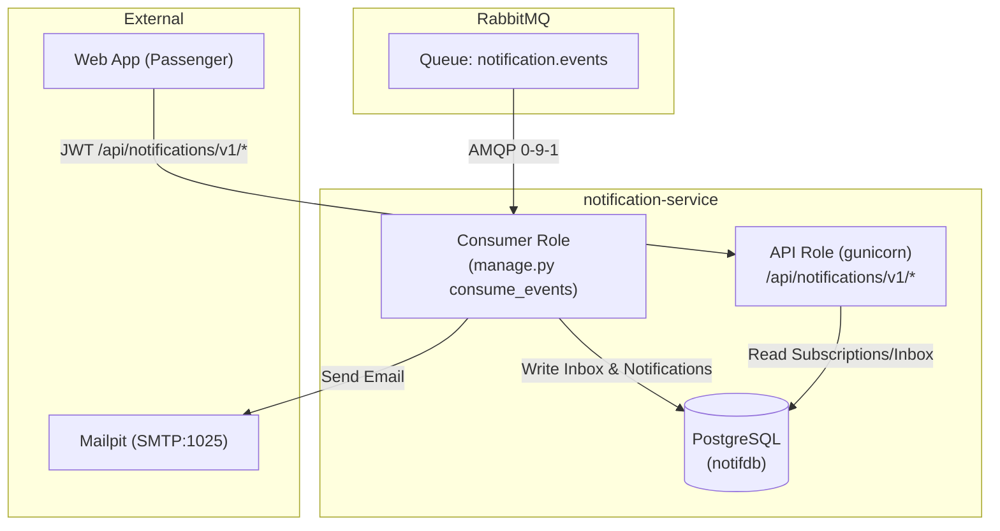

# Design — Notification Service

**Component:** `apps/notification-service`  
**Status:** Approved design for Milestone 2 slice & domain expansion

---

## 1. Architectural Overview

The Notification Service is an independently deployable Django/DRF microservice with its own dedicated PostgreSQL database (`notifdb`). It owns:
- Subscriptions to lines, stops, and scheduled trips (FR-060, FR-061).
- Passenger notification preferences per channel and change type (FR-062).
- In-app notification inbox and history (FR-067).
- Transactional event inbox for at-least-once message deduplication (FR-066, NFR-021).
- Notification issuance records tracking dispatch per `(event_id, passenger_id, channel)` (FR-066).

---

## 2. Data Models and DB Constraints

### 2.1 `subscriptions`
- `id` (UUIDv4, PK)
- `passenger_id` (UUID, indexed)
- `entity_type` (VARCHAR: `LINE`, `STOP`, `TRIP`)
- `entity_id` (VARCHAR: identifier of the subscribed line, stop, or trip)
- `active` (BOOLEAN, default True)
- `created_at`, `updated_at` (UTC timestamp)
- **Constraint:** `UniqueConstraint(passenger_id, entity_type, entity_id)`

### 2.2 `notification_preferences`
- `id` (UUIDv4, PK)
- `passenger_id` (UUID, indexed)
- `channel` (VARCHAR: `IN_APP`, `EMAIL`)
- `enabled` (BOOLEAN, default True)
- `enabled_change_types` (JSONB list, e.g. `['DISRUPTION', 'DELAY', 'SCHEDULE_CHANGE']`)
- **Constraint:** `UniqueConstraint(passenger_id, channel)`

### 2.3 `inbox_event` (Fixed Table Name per conventions.md)
- `id` (UUIDv4, PK)
- `event_id` (UUID, unique constraint for at-least-once deduplication)
- `event_type` (VARCHAR: e.g. `DisruptionChanged`, `TripStatusChanged`, `ScheduleChanged`)
- `producer` (VARCHAR: e.g. `core-backend`)
- `correlation_id` (VARCHAR)
- `payload` (JSONB)
- `processed_at` (UTC timestamp)

### 2.4 `inbox_notifications` (In-App Inbox, FR-067)
- `id` (UUIDv4, PK)
- `passenger_id` (UUID, indexed)
- `event_id` (UUID, indexed)
- `title` (VARCHAR)
- `body` (TEXT)
- `change_type` (VARCHAR)
- `entity_type` (VARCHAR)
- `entity_id` (VARCHAR)
- `read_at` (UTC timestamp, null if unread)
- **Constraint:** `UniqueConstraint(passenger_id, event_id)`

### 2.5 `notification_records` (FR-066 Deduplication Engine)
- `id` (UUIDv4, PK)
- `event_id` (UUID, indexed)
- `passenger_id` (UUID, indexed)
- `channel` (VARCHAR: `IN_APP`, `EMAIL`)
- `status` (VARCHAR: `PENDING`, `DELIVERED`, `FAILED`)
- `attempts` (INTEGER)
- `last_attempt_at` (UTC timestamp)
- `error_message` (TEXT)
- **Constraint:** `UniqueConstraint(event_id, passenger_id, channel)`

---

## 3. Deduplication and Overlap Rule (FR-065, FR-066)

1. When a change event arrives, the service queries active subscriptions matching the entity (or its parents, e.g. line containing the affected trip).
2. For each unique passenger:
   - Check preferences for active channels at event time (FR-068).
   - If a passenger matches via both line and stop, they are collapsed to **one** logical notification (FR-065).
3. The database constraint `(event_id, passenger_id, channel)` guarantees that even if a message is redelivered or reprocessed, duplicate records cannot be inserted (FR-066).
