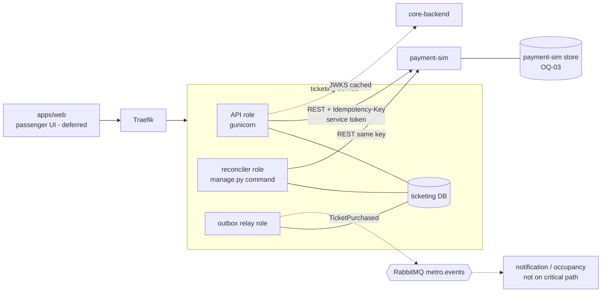
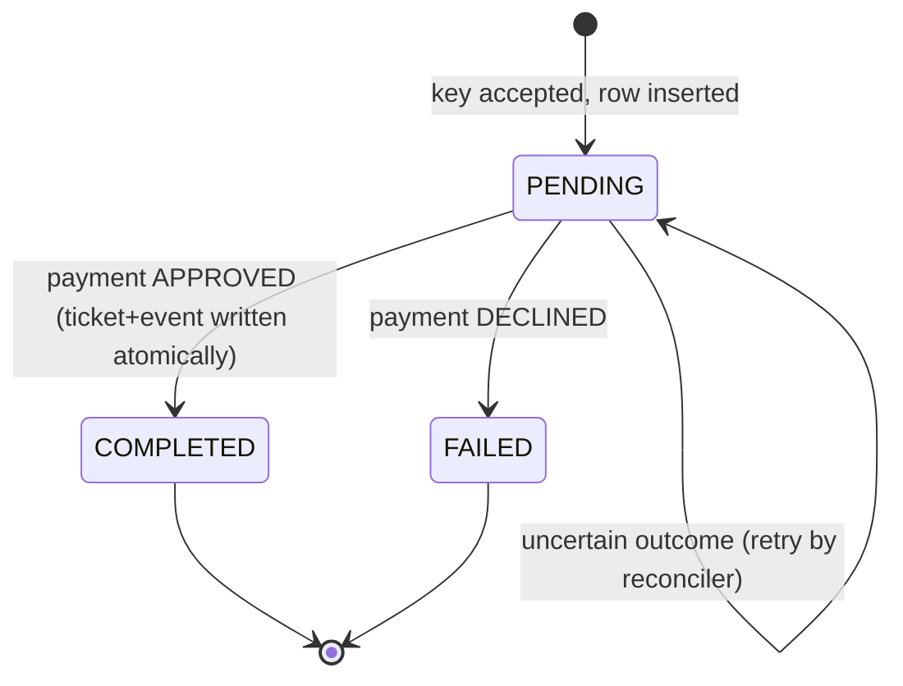
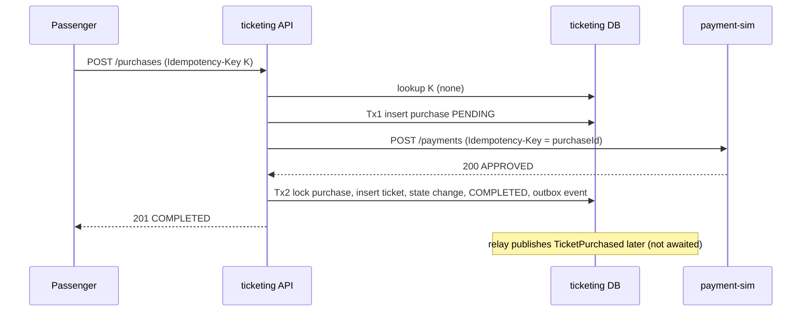
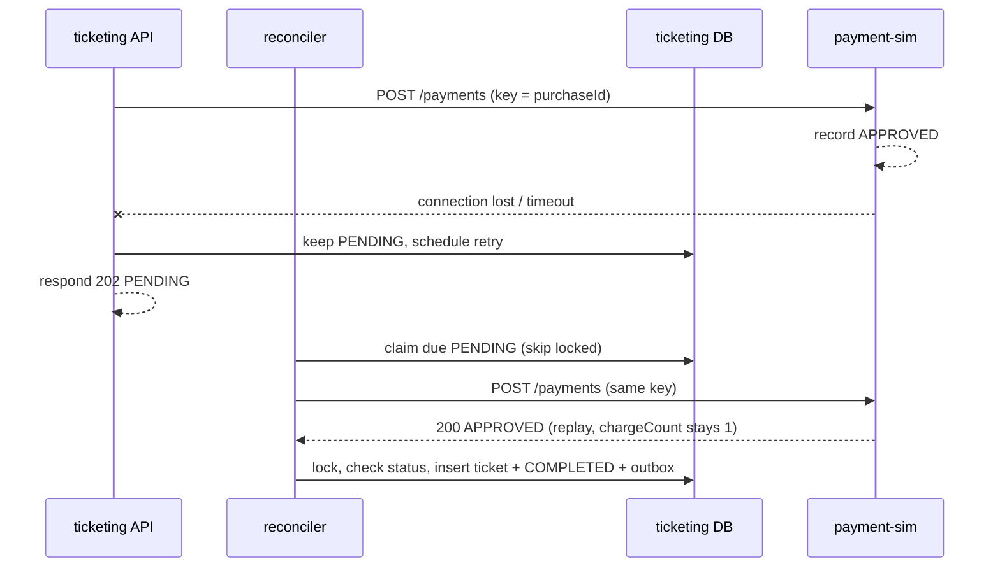

# Design — Ticket Purchase with Simulated Payment

**Status:** PRELIMINARY (PL6). Serves `requirements.md` (same folder). IDs `PUR-FR-xx`, `PUR-NFR-xx`, `Dxx`, `OQxx`, `ASxx` refer to that file.
**Scope of design:** the purchase write path, payment-sim, reconciliation and the `TicketPurchased` event. Ticket validation, ticket listing and notifications are out of scope.

## 1. Component view



Solid lines are the purchase's critical path (PUR-NFR-02). Dotted lines are never awaited by a purchase.

## 2. Components and responsibilities

| Component | Responsibility | Requirement |
|---|---|---|
| `ticketing-service` API role | Authenticate, validate, create purchase, call payment-sim, finalize, respond | FR-02..16 |
| `ticketing-service` reconciler role *(new — OQ-02)* | Find due `PENDING` purchases, replay payment with the same key, finalize | FR-12 |
| `ticketing-service` outbox relay role | Publish `TicketPurchased` with confirms; shared with future `TicketValidated` | FR-15, NFR-02 |
| `payment-sim` | Idempotent simulated payments, deterministic failure modes, test inspection endpoint | FR-08, D-05, D-11 |
| `core-backend` | Issues JWTs, publishes JWKS (dependency only) | FR-14 |
| `metro_common` | `TicketPurchased` Pydantic model, correlation/logging helpers (no domain logic) | FR-15 |

Layout inside `apps/ticketing-service` (follows conventions.md service layout; Django app names are a proposal and must be aligned with the validation feature, which shares `tickets`):

```text
ticket_types/   models.py selectors.py api/
tickets/        models.py (Ticket, TicketStateChange)   # shared with validation feature
purchases/      models.py services.py selectors.py clients.py events/
                api/ (views, serializers, permissions, urls)
                management/commands/reconcile_purchases.py
                tests/
```

`services.py` takes plain data and never sees the request; domain exceptions (`TicketTypeNotAvailable`, `PriceChanged`, `IdempotencyKeyReused`, `PaymentDeclined`) are mapped to responses by the single exception handler.

## 3. Data model

All tables: UUID `id`, `created_at`, `updated_at`, explicit `db_table`, UTC timestamps, money as `*_cents` + currency. Names below are proposals.

### `ticket_types` (owned by ticketing)
`code` (unique), `name`, `price_cents` (≥ 0, check), `currency` (3 chars, check), `terms` (JSONB: period of validity, journeys, conditions — shape owned by the ticket-type/validation features, see S-1), `status` (`ACTIVE`/`RETIRED`).

### `purchases`
| Column | Notes |
|---|---|
| `passenger_id` | UUID from JWT `sub`. No FK (belongs to core-backend). |
| `idempotency_key` | UUID from header. |
| `request_fingerprint` | SHA-256 of canonical JSON `{expectedPriceCents, paymentMethodToken, ticketTypeId}` (sorted keys, no whitespace). |
| `ticket_type_id` | FK (same service). |
| `terms_snapshot`, `price_cents`, `currency` | Frozen at creation (FR-06). |
| `status` | `PENDING` → `COMPLETED` \| `FAILED`. |
| `payment_id` | Set when approved. |
| `failure_code` | Set when `FAILED`. |
| `response_status`, `response_body` | Stored terminal response for replay (never contains `correlationId`; the handler injects the current one). |
| `attempts`, `next_attempt_at`, `last_attempt_at` | Reconciler scheduling. |
| `correlation_id`, `completed_at` | Traceability. |

Constraints (DB-level, named):
- `uq_purchases_passenger_key` — `UniqueConstraint(passenger_id, idempotency_key)`. Scope "per operation" is satisfied because each retry-safe operation has its own table.
- `ck_purchases_status` — status ∈ allowed set.
- `ck_purchases_terminal_has_response` — status ≠ `PENDING` ⇒ `response_status` not null.
- `ck_purchases_completed_has_payment` — `COMPLETED` ⇒ `payment_id` not null.
- Index `(status, next_attempt_at)` for the reconciler.

### `tickets`
`purchase_id` (FK, **`uq_tickets_purchase` unique** — the backstop for "exactly one ticket per payment", PUR-NFR-01), `passenger_id`, `ticket_type_id`, `terms_snapshot` (immutable copy, FR-081), `price_cents`, `currency`, `status` (initial `ISSUED`; later values belong to the validation feature, D-03), `issued_at`.

### `ticket_state_changes` (append-only; no UPDATE/DELETE)
`ticket_id`, `from_status` (null), `to_status` (`ISSUED`), `reason` (`PURCHASE`), `correlation_id`. UPDATE/DELETE are blocked at database level (trigger or revoked privileges — task T-04). Carries `updated_at` only to satisfy the base-model convention.

### `outbox_event` / `inbox_event`
Fixed names. Only `outbox_event` is used here. `event_id` is unique. `eventId` for `TicketPurchased` is `uuid5(NAMESPACE, "TicketPurchased:" + purchase_id)` so even a logic bug cannot create two events for one purchase (unique constraint). Shared outbox helper is used; if it does not exist yet it is created by T-05.

## 4. Purchase state machine


Only these transitions exist. Terminal states are never changed and never re-opened (D-12: nothing auto-fails a `PENDING`).

## 5. Interfaces

### 5.1 Ticketing REST (all documented with drf-spectacular; request + response serializers)

| Method / path | Auth | Purpose |
|---|---|---|
| `GET /api/ticketing/v1/ticket-types` | `AllowAny` (D-01) | Active types |
| `POST /api/ticketing/v1/purchases` | passenger | Create/replay purchase |
| `GET /api/ticketing/v1/purchases/{id}` | passenger, owner only | Status |

**POST /purchases** — headers `Authorization`, `Idempotency-Key`, `X-Correlation-Id`; body:
```json
{ "ticketTypeId": "uuid", "expectedPriceCents": 150, "paymentMethodToken": "sim_approve" }
```
| Outcome | Status | Body |
|---|---|---|
| Completed (or replay of completed) | 201 | `{id,status:"COMPLETED",ticketId,ticketTypeId,priceCents,currency,createdAt,completedAt}` |
| Pending (new, in progress, or replay) | 202 + `Location` + `Retry-After` | `{id,status:"PENDING",ticketTypeId,priceCents,currency,createdAt}` |
| Declined (or replay) | 422 | error `PAYMENT_DECLINED` |
| Price changed | 422 | `PRICE_CHANGED` |
| Type retired | 422 | `TICKET_TYPE_NOT_AVAILABLE` |
| Unknown type | 404 | `TICKET_TYPE_NOT_FOUND` |
| Key missing/malformed | 400 | `IDEMPOTENCY_KEY_REQUIRED` |
| Key reused, other payload | 409 | `IDEMPOTENCY_KEY_REUSED` |
| No/invalid token | 401 · wrong role 403 · throttled 429 (+`Retry-After`) · unexpected 500 · nothing recordable (own DB or cold JWKS down) 503 | standard error shape |

202 is a success-class response not listed in conventions.md's error table; adopting it is OQ-01.

### 5.2 payment-sim REST (namespace and storage: OQ-03)

`POST /api/payment-sim/v1/payments` — headers `Idempotency-Key` (= purchase id), service token, `X-Correlation-Id`; body `{amountCents, currency, paymentMethodToken}`.
Same key + same payload → replays the stored outcome. Same key + different payload → 409.
Success body: `200 {paymentId, status:"APPROVED"|"DECLINED", reason?}`.

| Token (D-11) | First call at sim | Later calls with the same key |
|---|---|---|
| `sim_approve` | records and returns APPROVED | same |
| `sim_decline` | records and returns DECLINED | same |
| `sim_slow` | records APPROVED, then waits > 3 s before responding | immediate APPROVED |
| `sim_lose_response` | records APPROVED, closes the connection with no response | immediate APPROVED |
| `sim_error` | returns 500, records nothing | APPROVED |
| any other | records and returns DECLINED `INVALID_PAYMENT_METHOD` | same |

`GET /api/payment-sim/v1/payments/{idempotencyKey}` (service token) returns `{status, paymentId, chargeCount, requestCount}` so tests can assert "exactly one charge".

### 5.3 Event `TicketPurchased` v1
Routing key `ticketing.ticket.purchased`; producer `ticketing-service`; envelope per conventions (`eventId`, `type`, `version`, `producer`, `occurredAt`, `correlationId`, `payload`).
Payload: `{purchaseId, ticketId, passengerId, ticketTypeId, priceCents, currency, issuedAt}` — UUIDs only, no personal data.
Semantics (declared per conventions): **activity event**, one per purchase, processed once per `eventId`; not a state snapshot, so no entity `version`. Additive changes only within v1. Pydantic model in `metro_common`; JSON Schema generated into `contracts/events`.

## 6. Core algorithms

### 6.1 Create purchase (API path)
1. Authenticate (JWT → `passenger_id`, `role`); permission check *before* business logic (FR-14).
2. Validate headers/body with serializers (FR-03). Compute fingerprint.
3. **Look up** `(passenger_id, key)`. Found:
   - fingerprint differs → 409;
   - `COMPLETED`/`FAILED` → return stored response;
   - `PENDING` → 202 with current state (never calls payment-sim itself).
4. Not found: read ticket type → 404/422 if absent/retired; price ≠ `expectedPriceCents` → 422 (FR-07, FR-16).
5. **Tx 1** (`atomic`): insert purchase `PENDING` with snapshot, `next_attempt_at = now + lease`. On `IntegrityError` on `uq_purchases_passenger_key` (a concurrent twin won) → roll back, go to step 3.
6. Outside any transaction: one payment attempt (`clients.pay`, timeouts 1 s/3 s, D-09).
7. `APPROVED` → `finalize_approved`; `DECLINED` → `finalize_declined`; anything else (timeout, connection error, 5xx, malformed body, 4xx other than the 409 contract error) → leave `PENDING`, schedule next attempt, log, respond 202.

### 6.2 Finalize (shared by API path and reconciler)
```text
with transaction.atomic():
    purchase = select_for_update(id)            # lock first
    if purchase.status != PENDING: return purchase   # check; idempotent no-op
    # write
    ticket = create Ticket(copy of purchase.terms_snapshot, price, currency, status=ISSUED)   # unique purchase_id backstop
    append TicketStateChange(ISSUED)
    purchase.status = COMPLETED; payment_id; response_status=201; response_body; completed_at
    outbox.enqueue(TicketPurchased, event_id=uuid5(...))   # same transaction
```
Decline path: lock, check, set `FAILED`, store 422 response; no ticket, no event. No HTTP call and no broker call ever happens while a lock is held.
Issuance copies the **purchase's snapshot**, not the live ticket type, so a retired type or changed price cannot alter what was paid for (FR-06, FR-17).

### 6.3 Reconciler (`manage.py reconcile_purchases`, one foreground process)
Loop: in a short transaction select `PENDING` rows with `next_attempt_at <= now` using `select_for_update(skip_locked=True)`, advance `next_attempt_at` (lease) and `attempts`, commit; then call `payment-sim` with the **same** key, then finalize as above. Several reconcilers may run; `payment-sim` idempotency plus the row lock plus `uq_tickets_purchase` are three independent guards against a second ticket. Backoff starting point: 5 s × 2ⁿ with jitter, capped at 5 min; lease 30 s (tunable by test or spec, per conventions). Purchases pending longer than an alert threshold (OQ-05) raise an operational alert but are never auto-failed (D-12). Time comes from the injectable `clock`.

## 7. Sequence diagrams

### 7.1 Happy path


### 7.2 Lost response and reconciliation


## 8. Failure handling

| # | Failure | Resulting state | Client sees | Recovery | Scenario |
|---|---|---|---|---|---|
| 1 | Invalid/missing token | none | 401 | — | AS-15 |
| 2 | Ticketing DB down before Tx1 | none | 503 | Safe client retry (key unused) | — |
| 3 | Crash after Tx1, before payment call | `PENDING` | no response / later 202 | Reconciler pays with the same key (first time at sim) → ticket | AS-08 variant |
| 4 | Payment timeout | `PENDING` | 202 | Reconciler replays | AS-06 |
| 5 | Sim 5xx or malformed body | `PENDING` | 202 | Reconciler replays; alert after threshold | — |
| 6 | Approved at sim, response lost | `PENDING` | 202 | Replay returns APPROVED, one charge | AS-07 |
| 7 | Crash after payment response, before Tx2 | `PENDING` | no response | Reconciler replays → finalize | AS-08 |
| 8 | Tx2 fails | whole transaction rolled back, still `PENDING` | 202/500 | Reconciler retries; never a ticket without `COMPLETED` | — |
| 9 | API and reconciler finalize at once | one wins on the row lock; other sees `COMPLETED`, no-op | — | `uq_tickets_purchase` is the backstop | AS-04 |
| 10 | RabbitMQ / notification / occupancy down | `COMPLETED`, outbox pending | 201 | Relay publishes after recovery, same `eventId` | AS-16 |
| 11 | Same key, different payload, concurrently | one insert wins, other 409 | 409 | — | AS-03 |
| 12 | JWKS unreachable | cached key used (D-13, OQ-06); cold cache → 503, nothing recorded | 503 | Retry later | — |
| 13 | payment-sim down | `PENDING` | 202 (OQ-01) | Reconciler after restart | AS-09 |

## 9. Security and consistency
- `passenger_id` always comes from the verified token, never the body. Another user's purchase is a 404 to avoid confirming it exists.
- The payment token is opaque, never logged, never in events or error messages (PUR-NFR-05, NFR-09). No card numbers are accepted or stored.
- Service-to-service calls use a service token, never a passenger token (conventions).
- Consistency model: one local transaction per business effect; cross-component agreement with `payment-sim` comes from **idempotent replay with a stable key** rather than a distributed transaction. The accepted window of inconsistency is "charged at the sim, ticket not yet issued", which is bounded by reconciliation and visible as `PENDING`.
- Known consequence (OQ-05): if a client abandons a request after the purchase row exists, the reconciler may still complete it, so an abandoned request can end in an issued ticket (no refunds in this product [P]).

## 10. Decisions, alternatives, assumptions
| Item | Decision / status | Alternative rejected | Why |
|---|---|---|---|
| Cross-component consistency | Idempotent replay + reconciliation | Saga with compensating refund | No refunds in product; sim supports replay |
| Reconciliation | Background command role | Lazy on client retry/read | Cannot guarantee completion if client never returns (OQ-02) |
| Idempotency storage | On the `purchases` row, DB unique constraint | Separate idempotency table | Fewer moving parts, atomic with the purchase |
| Event id | Deterministic `uuid5` | Random UUID | Uniqueness backstop |
| Payment path in request | One attempt (D-09) | 3 retries with backoff | Bounded latency, single retry mechanism |
| **Assumption [A]** | JWT carries `sub` (user UUID) and a role claim | — | Must be verified against core-backend's token format (task T-02) |
| **Assumption [A]** | Ticket type `terms` JSON shape is owned elsewhere; purchase copies it opaquely | — | Keeps purchase independent of validation rules (D-03) |

## 11. Deviations from conventions.md (each needs a team decision)
1. 202 `PENDING` when the dependency is unreachable instead of 503 (OQ-01).
2. New `reconciler` deployment role not listed in tech-stack.md (OQ-02).
3. `payment-sim` route namespace and a persistent store not in tech-stack.md/conventions.md (OQ-03).
4. One in-request payment attempt, narrower than the ≤3 allowed (D-09, within the rule).
5. `ticket_state_changes` carries `updated_at` though never updated (base-model convention).
