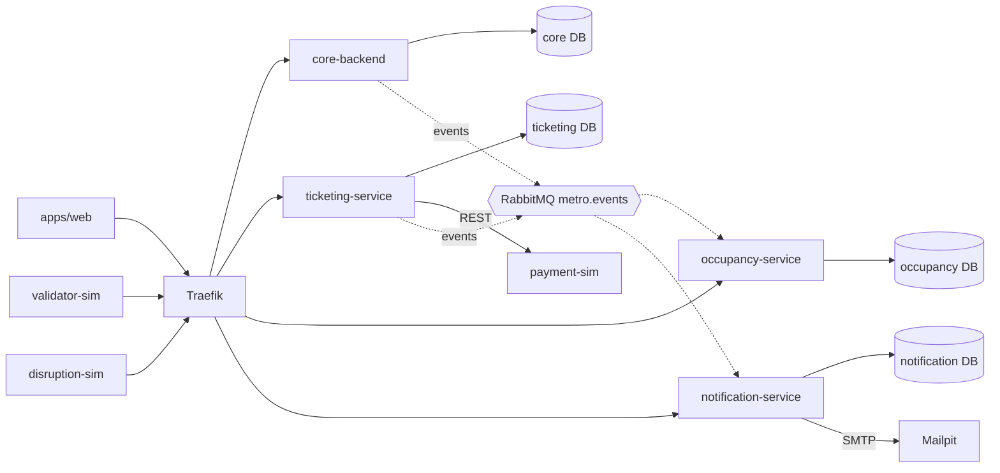

# Tech Stack — MetroIsJustABus

**Status:** adopted. The project statement and the requirements specification (v0.2) fix no technologies, so every choice below is a team decision. The few items that depend on information not yet available are listed at the end under "Open Items". Requirement IDs in brackets (NFR-xxx, FR-xxx) refer to the requirements specification.



## Repository layout

One monorepo. Each component is still built, tested, containerised and deployed on its own, with its own Dockerfile and pipeline job (NFR-003). A monorepo keeps every contract, test and deployment file in one place, which makes traceability (NFR-087, NFR-094) and agent context simpler.

```text
apps/
  web/                    # passenger + staff UI (React)
  core-backend/           # Django project: network, schedules, trips, disruptions, accounts, roles
  ticketing-service/      # Django project: ticket types, purchases, tickets, validation
  occupancy-service/      # Django project: boardings, occupancy estimates, crowding
  notification-service/   # Django project: subscriptions, preferences, inbox, e-mail
simulators/
  validator-sim/  payment-sim/  disruption-sim/
contracts/
  openapi/                # one REST contract per service (generated, committed)
  events/                 # event schemas (JSON Schema) + AsyncAPI document
packages/
  metro_common/           # event contracts (Pydantic) + logging/correlation helpers ONLY
infra/
  compose/                # local development
  stack/                  # dev and prod deployment definitions
  ansible/                # VM provisioning, runner setup
  observability/          # Prometheus, Grafana, Loki, alert rules
tests/
  system/                 # end-to-end and failure scenarios
  perf/                   # load tests
```

Each backend is its own Django project with its own settings, database and migrations. No Django app or model is shared between services. `packages/metro_common` holds only event contracts and cross-cutting plumbing, never domain logic or database access.

## Services (apps/)

All backend services share one stack, so a team of five and the AI agents work with one set of conventions.

- **Language/runtime:** Python (type-annotated), managed with uv and a lockfile
- **Framework:** Django with Django REST Framework (DRF)
- **Validation:** DRF serializers on every endpoint
- **Contracts:** OpenAPI generated from the serializers and views by drf-spectacular
- **Database:** PostgreSQL (psycopg 3), one dedicated instance per owning service
- **Data access and migrations:** Django ORM and Django migrations
- **Authorization:** DRF authentication and permission classes, defined inside each service (roles: visitor, passenger, staff)
- **Messaging:** pika (AMQP 0-9-1) with publisher confirms
- **Serving:** gunicorn
- **Logging:** structlog, structured JSON
- **Metrics:** django-prometheus on `/metrics`; `/health/live` and `/health/ready` on every service
- **Auth:** djangorestframework-simplejwt with asymmetric signing; argon2 password hasher

Each backend image supports separate deployment roles: the **API** (gunicorn), an **outbox relay** (`manage.py` command) when the backend publishes events, and an **event consumer** (`manage.py` command) for each consumer purpose it implements. Each role runs one foreground process in its own container and deployment service, so it restarts and scales independently. A backend does not deploy relay or consumer roles it does not need.

**Why:** DRF provides what the requirements ask for with little custom code: serializers for server-side input validation (NFR-055), permission classes for role enforcement and "a passenger sees only their own data" (FR-100 to FR-102, NFR-050), authentication classes, pagination and throttling. Django migrations satisfy versioned schema management (NFR-088). The ORM supports `select_for_update()`, unique constraints and transactions, which ticket validation needs (see "Why PostgreSQL?"). The Django admin site is not enabled, to avoid an unneeded attack surface. The trade-off is that DRF runs on synchronous workers and is heavier than a micro-framework. That is acceptable for the targets in NFR-040 and NFR-041, and load is handled by workers and replicas. A load test (NFR-043) decides whether that holds.

### apps/web
- **Framework:** React + Vite + TypeScript, built to static files and served by nginx
- **UI:** Tailwind CSS + Radix primitives (accessible by default)
- **Server state:** TanStack Query; persistence is limited to an allowlist of public consultation queries. Authenticated data stays in memory, scoped by user; logout and account changes cancel outstanding requests and clear cached data
- **Forms:** React Hook Form + Zod
- **API client:** openapi-fetch, typed with openapi-typescript types generated from the OpenAPI contracts; one shared client wrapper handles authentication and errors
- **i18n:** react-i18next, English first, text externalised

**Why:** The app is a client of the backends and needs no server-side rendering, so a static build is the simplest thing to containerise and deploy (NFR-060, NFR-096). Radix provides keyboard and screen-reader primitives; application composition and accessibility checks must still establish WCAG 2.1 AA conformance (NFR-061). Persisted public consultation data lets returning users see cached information when a backend is down, with a visible stale/unavailable banner; a first visit without cached data shows an unavailable state (NFR-023, NFR-024). Generated types and `tsc --noEmit` catch incompatible client usage at build time, while contract and system tests verify runtime behaviour. Staff pages live in the same app and are shown by role, as the requirements specify.

### apps/core-backend
Owns users and roles, network, schedules, trips and disruptions. Issues JWTs and publishes its public keys at a JWKS endpoint (a small custom view). Publishes `ScheduleChanged`, `DisruptionChanged` and `TripStatusChanged` through a transactional outbox.

### apps/ticketing-service
Owns ticket types, purchases, tickets and validations. Calls `payment-sim` synchronously with an idempotency key. Publishes `TicketPurchased` and `TicketValidated` through a transactional outbox.

### apps/occupancy-service
Owns attributed boardings, occupancy estimates and aggregates. Consumes `TicketValidated` and `ScheduleChanged`. Boardings are estimated from validations, not measured (FR-056). Per-trip attribution and crowding calculations depend on approval of A-03: a stop-entrance validation contains no line or trip, so it cannot be counted against a trip without that rule. Distinct accepted validations must each contribute once even when delivered out of order; only state snapshots use entity-version filtering.

### apps/notification-service
Owns subscriptions, preferences and notifications. Consumes the change events and `TicketPurchased`. Delivers to an in-app inbox and to e-mail through Django's SMTP backend. E-mail goes to Mailpit, a sandboxed SMTP server with a web inbox, never to real recipients (A-06).

The unique event/user/channel key prevents duplicate notification records. E-mail attempts and outcomes are recorded separately and retried on failure. An uncertain SMTP outcome can produce a duplicate on retry; database deduplication does not make external delivery exactly once.

### simulators/
Validator, payment and disruption simulators call the same public APIs as real clients. They are used in system tests, performance tests and the demo.

## Versions (majors)

Python 3.13 · Django 5.2 LTS · Django REST Framework 3.17 · Node.js 24 LTS (web build only) · PostgreSQL 18 · RabbitMQ 4.3 · Docker Engine (current stable)

Library versions are pinned in each lockfile; image versions are pinned by tag and digest in `infra/`. The reasons above do not change when versions do. When a major is bumped, record what changed that affects decisions.

## Architectural Decisions

### Why PostgreSQL, one instance per owning service?
Ticket validation must be strongly consistent per ticket (FR-046, NFR-030). Row locks (`select_for_update()` inside `transaction.atomic()`) stop a journey being spent twice under concurrency. Unique constraints (`UniqueConstraint`) enforce idempotency in the database, not only in code: one purchase per idempotency key (FR-033), one validation per validation request id (FR-045), one notification per event, user and channel (FR-066). With `USE_TZ` enabled, timestamps are stored as UTC (NFR-033). `JSONField` holds the validity rules per ticket type so new types need no redesign (FR-048). A separate instance per service enforces "no shared database access across component boundaries" (NFR-004, NFR-032) and lets each service be restarted on its own (NFR-003).

### Why RabbitMQ?
The requirements need retries and a dead-letter queue (NFR-016), durable events that survive a consumer outage (NFR-021), and consumers that tolerate duplicates and reordering (NFR-014). RabbitMQ provides dead-letter exchanges, durable queues, a management UI and a built-in Prometheus endpoint with queue depth (NFR-071). Kafka would add operational weight this system's volume does not justify. Delivery is at least once: consumers must tolerate duplicates and out-of-order events.

Durability requires durable exchanges and queues, persistent messages, topology declared before publishing, publisher confirms and mandatory routing. A relay keeps an event pending until it receives confirmation without a routing return; unconfirmed or unroutable publications are retried with the same event id and raise an operational alert. Retry and dead-letter transfers must use supported at-least-once dead-lettering or confirmed republishing before acknowledging the original delivery. Durable queues survive a broker restart with intact storage; a single broker and volume do not provide host or storage-loss resilience.

### Why a transactional outbox and an inbox table?
Publishing straight to the broker after a database commit can lose an event. Each publishing service writes the event to its `outbox_event` table in the same transaction as the state change. The relay worker then publishes it, reading with `select_for_update(skip_locked=True)` so several relays can run safely. Consumers record processed event ids in an `inbox_event` table with a unique constraint, so redelivery has no effect (NFR-013, NFR-015, NFR-022). Notification and occupancy outages never block purchase or validation (NFR-020).

### Why Celery is not used
Background event work uses outbox relays and event consumers, deployed as separate long-running `manage.py` commands with explicit acknowledgement and retry rules. Notification delivery also needs a retryable sender command for persisted delivery attempts, deployed separately when that feature is implemented. Scheduled backup commands are infrastructure jobs. Celery would add its own broker topology and task semantics on top of the RabbitMQ design the requirements ask us to justify and test.

### Why REST/JSON for synchronous calls and JSON events for asynchronous ones?
Purchase, validation and consultation need an immediate answer, and REST with OpenAPI is simple to test, document and consume from a browser or validator (NFR-010). Events use a common envelope: `eventId`, `type`, `version`, `producer`, `occurredAt`, `correlationId`, `payload`. The Pydantic models in `metro_common` are the source for the JSON Schema and AsyncAPI document in `contracts/events` (NFR-006). Every inter-component call has a timeout and defined failure behaviour (NFR-012).

### Why code-first contracts with a drift check?
DRF serializers and views define the HTTP contracts; Pydantic event models define the event payload contracts. drf-spectacular generates the OpenAPI files, the event models generate the event schemas, and both are committed. The pipeline fails if a committed contract differs from its generated form. For every supported API version, oasdiff compares the candidate with the released contract; event schemas have a separate compatibility check. A new major API or event schema version coexists with the old version until supported consumers have migrated.

Independent deployment also requires consumer contracts to pass against the provider versions supported during rollout and rollback, including consumers already deployed in production. Regenerating types and building the current monorepo is not sufficient evidence for those older consumers. Contract retirement requires an explicit migration decision; generated files cannot silently remove an interface still in use.

### Why JWT with JWKS, and no API gateway service?
Core-backend owns identity and signs tokens with a private key. Other services verify them with the public key published at its JWKS endpoint, so they never read its database (NFR-004, NFR-050). Validators and simulators authenticate with service credentials (NFR-053). Traefik routes by path and terminates TLS (NFR-052). A custom gateway would be one more component to build and one more point of failure.

### Why no Redis or cache layer?
No requirement needs one. Idempotency and deduplication live in PostgreSQL, and stale-tolerant consultation is handled by the browser cache. Every extra stateful component is another failure mode to test.

### Why Docker Swarm for dev and prod?
The statement requires containerisation, version-controlled deployment, a deployment strategy and rollback (NFR-096 to NFR-100), on infrastructure the team provisions itself. Swarm stack files use Compose syntax, so local and deployed definitions stay close. Swarm supports rolling updates, configurable automatic rollback and native secrets (NFR-054). Separate single-node dev and prod Swarms keep operation manageable within the project timeline. The trade-offs are a smaller ecosystem than Kubernetes, manual replica scaling (NFR-044 is only a "Could") and no production host-failure resilience.

### Why a rolling deployment?
The web and backend APIs run with at least two replicas in production. Relay, consumer and sender roles scale independently; multiple replicas require verified concurrent processing for that role. Stateless services are updated one task at a time with `parallelism: 1`, `order: start-first` and `failure_action: rollback`. Each deployment defines health checks, startup allowances, an update monitoring window and rollback settings; startup time and failure detection determine the window (NFR-073, NFR-100). Readiness-aware ingress routing and deployment smoke checks must verify service usability: task startup alone is not readiness. Failures outside the monitoring window require alerting and a pipeline rollback decision.

Stateful services (databases, broker) are never rolled automatically. Database migrations follow expand/contract, so old and new application versions work against the same schema during rollout and rollback; application rollback does not automatically undo a migration. Multiple application replicas on one VM reduce process and rollout downtime but do not tolerate loss of that VM. Host or persistent-storage failure requires the documented restore procedure and may cause downtime or loss since the last backup; recovery objectives remain to be approved.

## Delivery and Infrastructure

- **Source control and CI/CD:** GitHub (where the team's repository lives) and GitHub Actions. A self-hosted runner runs on the development VM and executes the integration and system tests (NFR-095)
- **Images:** one per component (API, relay, consumer and sender roles share their backend's image), tagged with the git SHA (and a release version), pushed to GitHub Container Registry. The same image is promoted from dev to prod, never rebuilt (NFR-091, NFR-094)
- **Environments:** `dev` and `prod` on separate VMs, each its own Swarm. Production deployment waits for a protected-environment approval after dev system tests and smoke checks pass (NFR-093)
- **Provisioning:** Ansible playbooks for Docker, Swarm, firewall and runner, so environments are rebuilt from the repository (NFR-097)
- **Configuration:** environment variables validated at startup with pydantic-settings. Secrets are Swarm secrets, read from `*_FILE` paths. Only `.env.example` is committed (NFR-054, NFR-099)
- **Ingress/TLS:** Traefik
- **Persistence and backup:** named volumes per database. Scheduled `pg_dump` per database to a backup volume copied off the host. Restore is documented and rehearsed (NFR-027)
- **Time zone:** UTC in storage, `OPERATING_TIMEZONE` (`Europe/Lisbon`) for display (NFR-033)

## Verification Tooling

| Purpose | Tool |
|---|---|
| Backend unit tests, coverage | pytest + pytest-django, coverage.py (threshold enforced in the pipeline) |
| Web unit tests | Vitest |
| Integration tests with real dependencies | testcontainers-python (PostgreSQL, RabbitMQ) |
| Contract tests between services (HTTP and messages) | Pact (pact-python), plus event schema validation |
| System / end-to-end tests | Playwright (Python bindings) against the deployed dev stack |
| Failure and recovery scenarios | Toxiproxy (latency, timeouts) and container stop/start |
| Accessibility | axe-core inside Playwright |
| Performance | k6 |
| Mutation testing | mutmut, on the validation and idempotency logic first |
| Static analysis and quality (backend) | ruff (lint and format), mypy with django-stubs and djangorestframework-stubs, bandit, Semgrep |
| Static analysis and quality (web) | `tsc --noEmit`, ESLint, Prettier |
| Dependency, image and secret scanning | Trivy, gitleaks |
| Web security baseline | OWASP ZAP baseline scan |

**Why:** each tool maps to a requirement: NFR-080 to NFR-086 for the test levels, NFR-025 and NFR-085 for failure scenarios, NFR-055 for security testing, NFR-084 for static analysis on every change. Testcontainers means integration tests run against real PostgreSQL and RabbitMQ, not mocks, which is what NFR-081 asks for. Using Python for backend and system tests keeps the whole test suite in one language.

**Adoption order:** establish formatting, linting, type checks, unit tests and secret scanning with the first implementation. Add real-dependency integration and contract checks when the first service interaction is introduced, and system smoke checks when the dev stack is deployable. Add failure, accessibility, performance, security and mutation checks as their relevant features become testable, before claiming their requirements are satisfied. Fast checks run on each pull request; longer checks run in feature acceptance and release pipelines, or earlier when a requirement demands it. Staging tool setup does not defer a required acceptance check.

## Observability

- **Logs:** structured JSON with `correlation_id`. Django middleware creates the id if absent; HTTP uses `X-Correlation-Id` and event envelopes use `correlationId`, carrying the same value across boundaries (NFR-070)
- **Metrics:** Prometheus scrapes every service and the RabbitMQ endpoint, covering request rate, errors, latency and queue depth (NFR-071)
- **Dashboards and alerts:** Grafana and Alertmanager, with an alert for the failure of any single component (NFR-072)
- **Log aggregation:** Loki with Grafana Alloy

## Open Items

The stack above is decided. These items wait on information the team does not have yet. None of them changes a choice above.

1. Infrastructure provider and VM sizing for dev and prod: unknown, so Ansible is used instead of provider-specific tooling
2. TLS certificates: Let's Encrypt needs a public domain. Otherwise use an internal CA
3. Django 5.2 LTS is chosen over the newer 6.x releases for its longer support window (to April 2028) and wider package compatibility. Check that the DRF-related packages used (drf-spectacular, simplejwt) support it when the lockfile is first created
4. Synchronous gunicorn workers: revisit only if the first performance test misses NFR-040 or NFR-041
5. Occupancy attribution rule (A-03), notification channels (A-06) and NFR target values: still open in the requirements, and they constrain the occupancy and notification services
