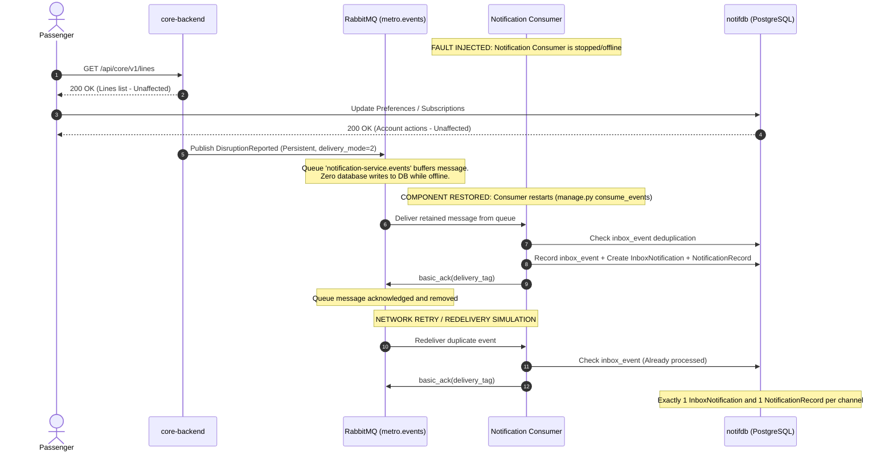

# E2E-06: Verification of Notification Outage, Event Retention and Recovery

- **Scenario ID:** E2E-06
- **Linear Issue:** [MET-183](https://linear.app/metroisjustabus-ase/issue/MET-183)
- **Component Scope:** `apps/notification-service`, RabbitMQ Message Broker, `apps/core-backend`
- **Related Requirements & Baseline Keys:** NFR-016, NFR-020, NFR-021, NFR-022, NFR-023, NFR-024, FR-063, FR-066, FR-067, ADR A-06

---

## 1. Purpose and Architecture

This acceptance test verifies the partial-failure resilience and eventual-consistency contract across the notification boundary:
1. **Component Isolation (NFR-020, NFR-023):** When the notification service or its consumer is unavailable or down, other system functions (such as line/stop consultations, passenger preference updates, and ticket purchases) remain fully operational and do not block or fail.
2. **Broker Event Retention (NFR-021, NFR-016):** Notification-triggering domain events (disruptions, schedule changes, delays) published during the notification component's outage are preserved without loss in durable RabbitMQ topic queues (`notification-service.events`).
3. **Reconciliation on Recovery (NFR-021):** When the notification component recovers and restarts, all retained events are processed in order, recorded in `inbox_event`, matched against passenger subscriptions, and delivered to in-app inboxes without data loss.
4. **Duplicate Prevention (NFR-022, FR-066):** If network retries or message replays deliver a retained event multiple times, exactly-once logical notification delivery is enforced via `inbox_event` and `(event_id, passenger_id, channel)` database unique constraints.

---

## 2. Fault Injection & Recovery Flow

---

## 3. Test Evidence and Verification Suite

The verification is automated and tracked in:
- **Test File:** [`apps/notification-service/notifications/tests/test_e2e_outage_recovery.py`](file:///Users/alex/Documents/mei/ASE/Project/MetroIsJustABus/apps/notification-service/notifications/tests/test_e2e_outage_recovery.py)
- **Requirement Markers:** `@pytest.mark.req("E2E-06", "NFR-020", "NFR-021", "NFR-022", "NFR-023")`

### Verified Scenarios:

1. **`test_e2e_unrelated_functions_unaffected_during_notification_outage`**:
   - Injects notification consumer failure.
   - Executes health probes (`/health/live`, `/health/ready`), subscription changes, and preference updates.
   - All operations return HTTP 200 without timeouts or error responses.
2. **`test_e2e_event_retention_during_outage_and_reconciliation_on_recovery`**:
   - Core backend emits a disruption event while consumer is offline.
   - Broker queue retains the message (`len(queue) == 1`).
   - Zero database state changes occur while offline (`InboxNotification.count() == 0`, `InboxEvent.count() == 0`).
   - Consumer restores via `consume_batch()`.
   - All retained messages reconcile into `inbox_event` and `inbox_notifications`.
   - Message is acknowledged (`basic_ack`).
3. **`test_e2e_replayed_retained_events_produce_no_duplicate_effects`**:
   - Replays identical event envelope to restored consumer.
   - Consumer skips reprocessing; zero duplicate notification records created.
4. **`test_e2e_multiple_events_accumulated_during_extended_outage_reconcile_completely`**:
   - Multiple disruptions and timetable changes for different lines accumulate during extended downtime.
   - On recovery, all events reconcile completely across all affected passenger inboxes.

---

## 4. Limitations and Operational Boundaries

1. **Persistent Storage Dependency (Principle 5):**
   - The guarantee that notification events survive an outage assumes that RabbitMQ's persistent queue storage and PostgreSQL's volumes remain intact. If the underlying database volume is lost, recovery requires standard backup restoration procedures.
2. **Delivery Decoupling (ADR A-06):**
   - In-app inbox records are atomic with event consumption. Email dispatch is measured at provider handover (`mailpit:1025`) and does not claim end-user internet mail delivery guarantees.
